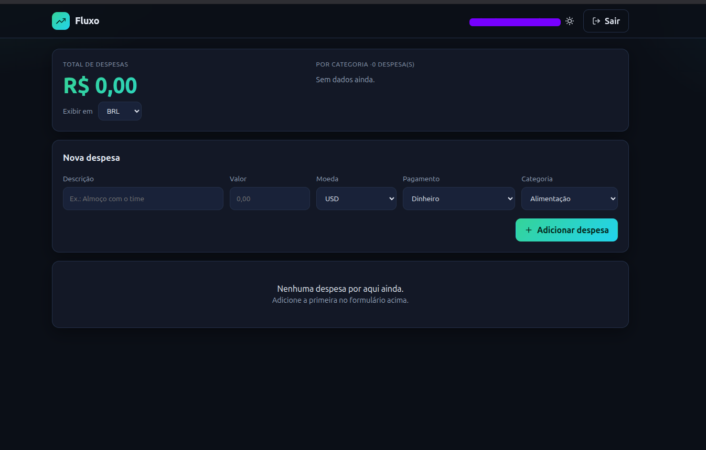
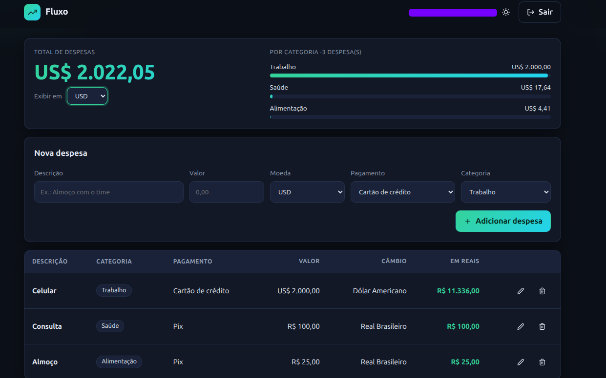
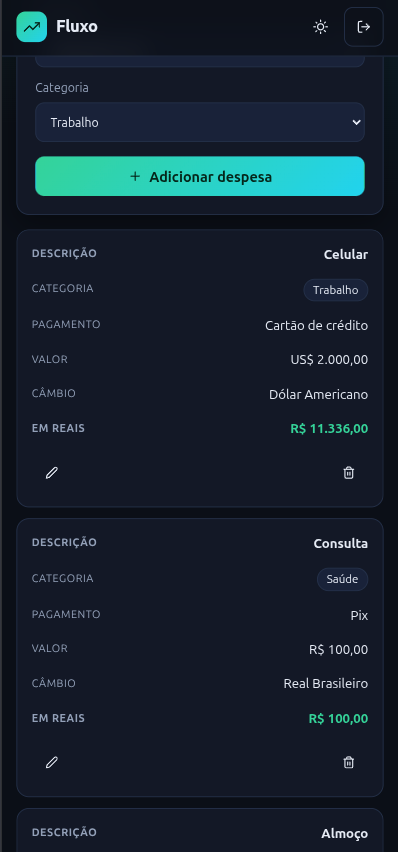
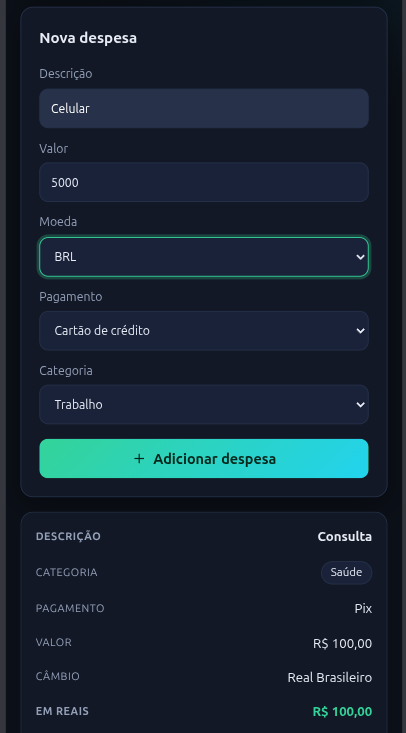

# 💸 Flux

Flux is a personal finance tracker built to help people control spending across multiple currencies. It allows users to log expenses in their preferred currency, keep the exchange rate fixed at the moment each entry is created, and review totals in the currency they want to monitor. The app is designed to make day-to-day budgeting clearer, especially for users who deal with international transactions or multiple spending categories.

## ✨ Features

- Add, edit, and remove expenses with description, amount, currency, payment method, and category.
- Lock the exchange rate when the expense is created so the converted value stays consistent over time.
- View the overall total in the selected currency, with category-based summaries.
- Authenticate with email/password, keep routes protected, and separate data by user.
- Toggle between dark and light themes.
- Enjoy a responsive UI with table layout on larger screens and card layout on mobile.

## 📸 Screenshots

Desktop
<p align="center">
  <td>
    
  </td>
  <td>
    
  </td>
</p>

Mobile
<table>
  <tr>
  <td>
    
  <td>
    
  </td>
  </tr>
</table>

---

## 🌐 Live demo

- Deploy: https://flux-xdmo.onrender.com/

## 🧰 Tech stack

### Frontend
- React 18
- TypeScript
- Vite
- Redux Toolkit
- React Router
- React Icons
- CSS

### Backend & auth
- Supabase Auth
- Local demo authentication for testing without external configuration

### Data & integrations
- AwesomeAPI exchange rates
- Browser localStorage for persistence

### Quality & testing
- Vitest
- Testing Library
- ESLint

## 🚀 Running locally

1. Install dependencies:

```bash
npm install
```

2. Create the environment file if using the real Supabase authentication flow:

```bash
cp .env.example .env
```

Then fill in:
- `VITE_SUPABASE_URL`
- `VITE_SUPABASE_ANON_KEY`

3. Start the app:

```bash
npm run dev
```

The app will be available at:

```text
http://localhost:3000
```

## 📜 Available scripts

| Script | Purpose |
| --- | --- |
| `npm run dev` | Start the development server |
| `npm run build` | Run type-checking and production build |
| `npm test` | Execute the test suite |
| `npm run lint` | Run ESLint |
| `npm run preview` | Preview the production build locally |

## 🔐 Authentication

This app supports two modes:

### Supabase mode

Using a real authentication provider is the safer option for production. Supabase handles password hashing, session management, token refresh, and email confirmation.

1. Create a project in Supabase.
2. Copy `.env.example` to `.env` and fill in the values from the project API settings.
3. Enable email authentication in the Supabase dashboard.

### Demo mode

If the environment variables are not set, the app falls back to a browser-local demo authentication flow. This is useful for testing the UI and flows without external configuration, but it is not intended for real production use.

> In demo mode, expenses are kept in the browser localStorage and separated by user. They are not synced across devices.

## 🗂️ Project structure

```text
src/
├── auth/          # Authentication providers (Supabase and demo)
├── components/    # UI blocks such as forms, lists, summary, header, and routes
├── pages/         # Login and wallet screens
├── redux/         # Store, slices, and persistence
├── api.ts         # Exchange rate fetching
├── tests/         # Test helpers and utilities
└── ...
```
